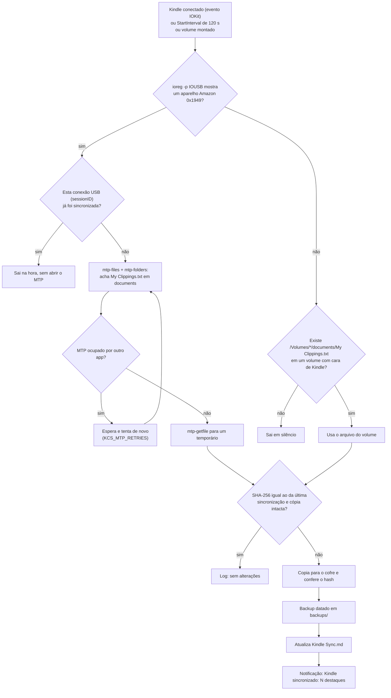

# kindle-clippings-sync

Automação para macOS que copia o arquivo `My Clippings.txt` do Kindle para o cofre do Obsidian toda vez que o Kindle é conectado ao Mac via USB. Depois, o assistente de leitura transforma esses destaques em notas de capítulo de cada livro.

Funciona com os dois tipos de Kindle:

- **MTP** (Kindle Paperwhite e outros modelos recentes): o aparelho **não monta** em `/Volumes`; aparece só como dispositivo USB (Amazon, `idVendor 0x1949`; o Paperwhite testado é `idProduct 0x9981`). O arquivo é baixado com as ferramentas do [libmtp](https://github.com/libmtp/libmtp) (`brew install libmtp`).
- **Armazenamento USB** (modelos antigos): monta em `/Volumes/Kindle` e o arquivo é lido direto de `/Volumes/*/documents/My Clippings.txt`. Continua funcionando como alternativa.

Além do libmtp, usa só o que vem no macOS: `bash` 3.2, `launchd`, `ioreg`, `shasum` e `osascript`. Não precisa de `python3`.

## O que faz

1. O `launchd` dispara o job quando o Kindle é conectado (evento de IOKit), a cada 120 s como reserva e a cada volume montado.
2. O script consulta o `ioreg -p IOUSB` (barato, não abre o MTP). Se não há Kindle no USB, procura em `/Volumes`; se não há nada, sai em silêncio.
3. **Kindle MTP:** se essa conexão USB (o `sessionID` do aparelho) já foi sincronizada, sai na hora. Senão, roda `mtp-files` e `mtp-folders`, encontra o item `My Clippings.txt` cuja pasta pai é `documents` (na raiz do armazenamento, de preferência) e baixa com `mtp-getfile` para um arquivo temporário, conferindo o tamanho.
4. **Kindle em `/Volumes`:** só aceita volumes com cara de Kindle (nome com "kindle", pasta `system/`, `.kindle`, `system/version.txt` ou `amazon-cover-bug`).
5. Compara o SHA-256 com o da última sincronização. Se nada mudou, não toca no cofre.
6. Se mudou, copia os bytes exatamente como estão (UTF-8 com BOM e quebras CRLF preservados) para:
   - `<destino>/My Clippings.txt`
   - `<destino>/backups/My Clippings AAAA-MM-DD HHMMSS.txt` (cópia datada)
7. Escreve ou atualiza `<destino>/Kindle Sync.md`, uma nota com frontmatter YAML (tags, data da última sincronização, número de entradas contadas pelos separadores `==========`, origem).
8. Mostra a notificação "Kindle sincronizado: N destaques".
9. Registra tudo em `~/Library/Logs/kindle-clippings-sync.log`.

Execuções simultâneas são seguras (lock por diretório, com detecção de lock obsoleto), a cópia é atômica (temporário, conferência do hash, troca) e cada comando `mtp-*` tem tempo limite.



## Gatilho: como o job é disparado

Um Kindle MTP não gera evento de montagem, então o `StartOnMount` não serve para ele. O LaunchAgent combina três gatilhos:

1. **Conexão USB (`LaunchEvents` / `com.apple.iokit.matching`)**, casando `IOProviderClass = IOUSBHostDevice`, `idVendor = 6473` (0x1949) e `idProduct = 39297` (0x9981), com `IOMatchLaunchStream`. É o que faz a sincronização acontecer segundos depois de plugar o cabo.
   - Esse tipo de evento precisa ser "aceito" pelo processo com `xpc_set_event_stream_handler()`. Se o job sair sem isso, o `launchd` considera o evento pendente e relança o job em loop enquanto o aparelho estiver conectado. Um script bash não consegue chamar essa API, por isso existe o `helper/kcs-iokit-trigger.c`: um programa C mínimo que o `install.sh` compila (precisa das Command Line Tools: `xcode-select --install`). Ele consome o evento, espera ~1 s e faz `execv` para `/bin/bash kindle-clippings-sync` (não fica residente).
   - Mesmo assim o evento pode disparar mais de uma vez (reconexões, o Kindle trocando de modo USB, ou o `launchd` reentregando). Isso é inofensivo: o script guarda o `sessionID` da conexão já sincronizada e sai sem abrir o MTP.
   - Sem compilador, o instalador **não** coloca o `LaunchEvents` no plist (para evitar o loop) e avisa; fica valendo o item 2.
2. **`StartInterval` de 120 s (reserva).** Custa só um `ioreg` quando não há Kindle; com o Kindle conectado e já sincronizado, também sai na hora. Ajuste com `--interval N` ou desligue com `--interval 0`.
3. **`StartOnMount`** para Kindles antigos que montam em `/Volumes`.

Por padrão cada conexão é sincronizada uma vez. Se você costuma deixar o Kindle conectado e lendo, use `KCS_MTP_RESYNC_SECONDS=1800` (por exemplo) para ler de novo a cada 30 min enquanto estiver conectado.

Outros Kindles têm outro `idProduct`. Veja o seu com `ioreg -p IOUSB -l -w0 | grep -E '"(USB Product Name|idVendor|idProduct)"'` e reinstale com `--product-id N` (decimal), ou `--product-id any` para qualquer aparelho Amazon.

## Instalação

No Mac, no Terminal:

```bash
xcode-select --install          # se ainda não tiver as Command Line Tools (para o helper)
brew install libmtp             # ou deixe o install.sh fazer isso com --install-deps
git clone https://github.com/<usuario>/kindle-clippings-sync.git ~/Developer/kindle-clippings-sync
cd ~/Developer/kindle-clippings-sync
bash tests/run-tests.sh         # opcional: testes num ambiente falso
./install.sh --install-deps --test
```

Com o Kindle conectado, `./install.sh --run-now` dispara o job pelo próprio `launchd` (o mesmo contexto de permissões do uso real) e mostra o log.

O instalador:

- confere o libmtp (`mtp-files`, `mtp-folders`, `mtp-getfile` no PATH, em `/opt/homebrew/bin` ou `/usr/local/bin`) e mostra `brew install libmtp` se faltar; com `--install-deps` instala pelo Homebrew;
- copia o script para `~/.local/bin/kindle-clippings-sync`;
- compila o helper em `~/.local/libexec/kindle-clippings-sync/kcs-iokit-trigger`;
- grava a config em `~/.config/kindle-clippings-sync/config.env`;
- gera `~/Library/LaunchAgents/digital.gabriel.kindle-clippings-sync.plist` a partir do template em `launchd/`;
- carrega o job com `launchctl bootstrap gui/$(id -u)` (ou `launchctl load -w`, se o primeiro falhar).

Pode rodar o `install.sh` de novo quantas vezes quiser (por exemplo depois de um `git pull`): ele substitui script, helper e plist, recarrega o job e mantém a config existente.

| Opção | Efeito |
| --- | --- |
| `--vault CAMINHO` | caminho do cofre do Obsidian |
| `--dest-subdir PASTA` | pasta dentro do cofre |
| `--prefix DIR` | onde instalar o script (padrão `~/.local/bin`) |
| `--install-deps` | roda `brew install libmtp` se o libmtp faltar |
| `--product-id N\|any` | `idProduct` do gatilho USB (padrão `39297` = 0x9981) |
| `--interval N` | `StartInterval` de reserva em segundos (padrão `120`; `0` desliga) |
| `--no-iokit` | não usa o gatilho de conexão USB |
| `--helper-bin CAMINHO` | usa um helper já compilado |
| `--test` | depois de instalar, roda o script no Terminal (`--now`) |
| `--run-now` | depois de instalar, dispara via `launchctl kickstart` e mostra o log |
| `--no-load` | só gera os arquivos, sem carregar no `launchd` |

## Desinstalação

```bash
./uninstall.sh           # remove o LaunchAgent, o script e o helper
./uninstall.sh --purge   # também apaga config, estado interno e log
```

Nada dentro do cofre do Obsidian é apagado: a cópia, os backups e a nota continuam lá. O libmtp continua instalado (`brew uninstall libmtp` se quiser).

## Configuração

O arquivo `~/.config/kindle-clippings-sync/config.env` é um shell simples e pode ser editado à mão. Variáveis de ambiente com o mesmo nome têm prioridade. Mudanças de gatilho (`KCS_USB_PRODUCT_ID`, `KCS_START_INTERVAL`, `KCS_IOKIT_TRIGGER`) só valem depois de rodar `./install.sh` de novo.

| Variável | Padrão | Descrição |
| --- | --- | --- |
| `KCS_VAULT` | `~/Library/Mobile Documents/iCloud~md~obsidian/Documents` | cofre do Obsidian |
| `KCS_DEST_SUBDIR` | `05 Conhecimento/Leituras/_Kindle` | pasta dentro do cofre |
| `KCS_DEST` | (vazio) | caminho absoluto do destino; ignora as duas anteriores |
| `KCS_SOURCE` | `auto` | `auto` (MTP, depois `/Volumes`), `mtp` ou `volumes` |
| `KCS_NOTIFY` | `1` | `0` desliga a notificação |
| `KCS_MAX_BACKUPS` | `0` | manter só os N backups mais recentes (`0` mantém todos) |
| `KCS_USB_VENDOR_ID` | `6473` | `idVendor` do Kindle (0x1949, Amazon) |
| `KCS_USB_PRODUCT_ID` | `39297` | `idProduct` do gatilho USB (0x9981) ou `any` |
| `KCS_START_INTERVAL` | `120` | `StartInterval` de reserva |
| `KCS_IOKIT_TRIGGER` | `1` | `0` desliga o gatilho de conexão USB |
| `KCS_MTP_BIN_DIR` | (vazio) | pasta dos `mtp-*`; vazio = PATH, `/opt/homebrew/bin`, `/usr/local/bin` |
| `KCS_MTP_DELAY` | `3` | segundos de espera depois de detectar o Kindle |
| `KCS_MTP_RETRIES` | `4` | tentativas quando o MTP está ocupado |
| `KCS_MTP_RETRY_INTERVAL` | `10` | segundos entre tentativas |
| `KCS_MTP_TIMEOUT` | `180` | tempo máximo de cada comando `mtp-*` |
| `KCS_MTP_RESYNC_SECONDS` | `0` | `0` = uma vez por conexão; N = de novo a cada N s conectado |
| `KCS_MTP_KILL_PTPCAMERAD` | `0` | `1` = encerra o `ptpcamerad` do macOS se o MTP estiver ocupado |
| `KCS_VOLUMES_ROOT` | `/Volumes` | onde procurar volumes montados |
| `KCS_MOUNT_DELAY` | `5` | espera depois de uma montagem recente |
| `KCS_RETRIES` / `KCS_RETRY_INTERVAL` | `3` / `5` | tentativas em `/Volumes` |
| `KCS_REQUIRE_MARKER` | `1` | `0` aceita qualquer volume com `documents/My Clippings.txt` |
| `KCS_LOG` | `~/Library/Logs/kindle-clippings-sync.log` | arquivo de log |
| `KCS_STATE_DIR` | `~/Library/Application Support/kindle-clippings-sync` | hash, sessão USB e lock |

O caminho do cofre tem espaços e til, então use sempre aspas simples na config, como o instalador já faz:

```bash
KCS_VAULT='/Users/gabrielhenrique/Library/Mobile Documents/iCloud~md~obsidian/Documents'
```

Execução manual:

```bash
~/.local/bin/kindle-clippings-sync --now           # sem espera e ignorando "já sincronizado nesta conexão"
~/.local/bin/kindle-clippings-sync --now --force   # copia mesmo sem mudança
```

## Kindle ocupado por outro app (MTP)

Só um programa por vez consegue abrir um aparelho MTP. Se outro app estiver com o Kindle, o libmtp falha com mensagens como `libusb_claim_interface() reports device is busy`, `Unable to open raw device 0` ou `LIBMTP PANIC: Unable to initialize device`. Os suspeitos de sempre:

- **Android File Transfer** (e o processo `Android File Transfer Agent`, que abre sozinho quando um aparelho MTP é conectado);
- **OpenMTP**, **MacDroid** e similares;
- o app **Kindle** / **Send to Kindle** da Amazon;
- **Captura de Imagem**, **Fotos** ou o serviço do sistema `ptpcamerad`, que às vezes pega aparelhos MTP/PTP.

O que o script faz: tenta de novo `KCS_MTP_RETRIES` vezes, registra no log quais desses processos estão rodando e a mensagem do libusb, e mostra uma notificação "Kindle ocupado por outro app" (uma vez por conexão). Como a conexão não foi marcada como sincronizada, o próximo `StartInterval` tenta de novo sozinho (uma tentativa por rodada, para não encher o log).

O que você faz: feche o app (`killall "Android File Transfer" "Android File Transfer Agent"`), desconecte e reconecte o Kindle ou rode `~/.local/bin/kindle-clippings-sync --now`. Se o culpado for o `ptpcamerad`, `KCS_MTP_KILL_PTPCAMERAD=1` encerra o processo antes de tentar de novo (o macOS o reinicia sozinho depois).

## Permissões do macOS (TCC)

O job roda como `/bin/bash` disparado pelo `launchd`, fora do Terminal. Por isso ele não herda as permissões que o Terminal já tem, e o macOS pode bloquear:

- **iCloud Drive** (`~/Library/Mobile Documents`, onde fica o cofre);
- **Volumes removíveis** (`/Volumes/Kindle`, só nos Kindles antigos). O acesso MTP é feito direto pelo USB e, até onde se sabe, não passa por essa permissão.

Sintomas: o Kindle está conectado mas nada acontece, ou o log mostra `Operation not permitted`, `sem permissão para listar` ou `falha ao copiar`.

Como liberar:

1. Abra **Ajustes do Sistema > Privacidade e Segurança**.
2. Se aparecer um pedido de acesso para `bash` ou `kcs-iokit-trigger`, clique em **Permitir**.
3. Se não aparecer pedido e mesmo assim falhar, vá em **Acesso Total ao Disco**, clique em **+**, pressione `Cmd+Shift+G`, digite `/bin/bash` e ative. Alternativa mais restrita: em **Arquivos e Pastas**, ative **Volumes Removíveis** para `bash`, se ele estiver listado.
4. Desconecte e conecte o Kindle de novo.

Observação: dar Acesso Total ao Disco para `/bin/bash` vale para qualquer script bash, não só este. Tente primeiro sem isso; com o Kindle MTP normalmente só o iCloud Drive importa.

Notificações aparecem em nome do **Editor de Scripts** (o `osascript`). Se não aparecerem, confira em **Ajustes do Sistema > Notificações > Editor de Scripts**.

## Diagnóstico

```bash
tail -f ~/Library/Logs/kindle-clippings-sync.log
launchctl print gui/$(id -u)/digital.gabriel.kindle-clippings-sync | head -n 40
ioreg -p IOUSB -l -w0 | grep -E '"(USB Product Name|idVendor|idProduct|sessionID)"'
mtp-detect | head -n 20       # o libmtp enxerga o Kindle?
mtp-folders                   # deve listar a pasta documents
log show --last 10m --predicate 'subsystem == "com.apple.TCC"' | grep -i -E 'bash|kcs'
```

Notas:

- Sem Kindle conectado, ou com a conexão já sincronizada, o script sai sem escrever nada no log.
- O libmtp pode chamar o 1949:9981 de "Kindle Scribe 32GB" ou dizer que o aparelho é `UNKNOWN in libmtp` e pedir para reportar. É só o nome na tabela interna dele; o acesso funciona como MTP genérico.

## Limitações conhecidas

- O helper do evento de IOKit é compilado no Mac; se as Command Line Tools não estiverem instaladas, o gatilho fica só no `StartInterval` (até 2 min de atraso).
- Se houver dois Kindles conectados ao mesmo tempo, só o primeiro é sincronizado.
- O download via MTP lê a lista de arquivos do aparelho inteiro; com bibliotecas grandes pode levar alguns segundos.

## Testes

```bash
bash tests/run-tests.sh
bash tests/lint.sh
```

Os testes rodam em Linux ou macOS com um `/Volumes`, um cofre e um `HOME` falsos e com versões falsas de `ioreg`, `mtp-files`, `mtp-folders`, `mtp-getfile`, `mtp-detect`, `brew` e `osascript` em `tests/fakes/`. As saídas falsas seguem o formato do libmtp 1.1.22 (`examples/files.c`, `folders.c`, `getfile.c` e as mensagens de erro de `src/libusb1-glue.c`) e do `ioreg -p IOUSB -l -w0` de um Mac Apple Silicon. Cobrem, entre outros:

- `/Volumes`: ausência de Kindle, pendrive sem marcador, cópia byte a byte com BOM e CRLF, backup, execução sem mudança, nova entrada, lock, `--force`, config por arquivo, cofre inexistente;
- MTP: Kindle ausente no `ioreg` (nenhum `mtp-*` é chamado), escolha da cópia em `documents` entre iscas em outras pastas, reexecução na mesma conexão sem abrir o MTP, reconexão, aparelho ocupado (com e sem recuperação), `No devices.` no `mtp-getfile`, comando travado (timeout), aparelho sem `My Clippings.txt`, libmtp ausente, ferramentas achadas pelo PATH, prioridade do MTP sobre `/Volumes`;
- instalador: plist com e sem helper (`LaunchEvents`, `idVendor`, `idProduct`, `StartInterval`), `--product-id any`, `--interval`, `--no-iokit`, `--install-deps`, reinstalação preservando a config, execução ponta a ponta pelo helper e desinstalação.

`tests/lint.sh` roda o `shellcheck` e valida os plists gerados (`plutil`, `xmllint` ou `python3` com o DTD da Apple, o que existir).

## Licença

MIT. Veja [LICENSE](LICENSE).
