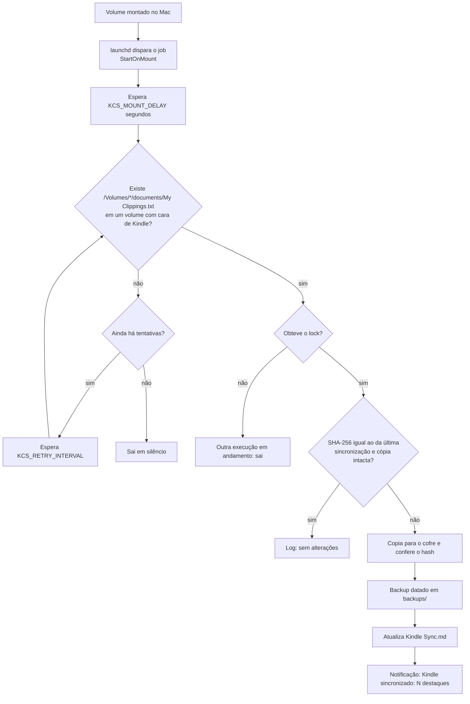

# kindle-clippings-sync

Automação para macOS que copia o arquivo `My Clippings.txt` do Kindle para o cofre do Obsidian toda vez que o Kindle é conectado ao Mac via USB. Depois, o assistente de leitura transforma esses destaques em notas de capítulo de cada livro.

Usa apenas o que já vem no macOS: `bash`, `launchd`, `shasum` e `osascript`. Não precisa de Homebrew nem de `python3`.

## O que faz

1. O `launchd` dispara o script a cada volume montado (`StartOnMount`).
2. O script espera alguns segundos para o volume terminar de montar e procura `/Volumes/*/documents/My Clippings.txt`.
3. Só aceita volumes que parecem um Kindle: nome contendo "kindle", pasta `system/`, arquivo `.kindle`, `system/version.txt` ou `amazon-cover-bug`. Um pendrive qualquer é ignorado.
4. Compara o SHA-256 com o da última sincronização. Se nada mudou, sai em silêncio.
5. Se mudou, copia os bytes exatamente como estão (UTF-8 com BOM e quebras CRLF preservados) para:
   - `<destino>/My Clippings.txt`
   - `<destino>/backups/My Clippings AAAA-MM-DD HHMMSS.txt` (cópia datada)
6. Escreve ou atualiza `<destino>/Kindle Sync.md`, uma nota com frontmatter YAML (tags, data da última sincronização, número de entradas contadas pelos separadores `==========`).
7. Mostra a notificação "Kindle sincronizado: N destaques".
8. Registra tudo em `~/Library/Logs/kindle-clippings-sync.log`.

Execuções simultâneas são seguras (lock por diretório, com detecção de lock obsoleto) e a cópia é atômica: grava num arquivo temporário, confere o hash e só então troca.



## Instalação

No Mac, no Terminal:

```bash
git clone https://github.com/<usuario>/kindle-clippings-sync.git ~/Developer/kindle-clippings-sync
cd ~/Developer/kindle-clippings-sync
bash tests/run-tests.sh      # opcional: roda os testes num ambiente falso
./install.sh --test          # instala, carrega o LaunchAgent e roda uma vez
```

Com o Kindle conectado, `./install.sh --run-now` dispara o job pelo próprio `launchd` (o mesmo contexto de permissões do uso real) e mostra o log.

O instalador:

- copia o script para `~/.local/bin/kindle-clippings-sync`;
- grava a config em `~/.config/kindle-clippings-sync/config.env`;
- gera `~/Library/LaunchAgents/digital.gabriel.kindle-clippings-sync.plist` a partir do template em `launchd/`;
- carrega o job com `launchctl bootstrap gui/$(id -u)` (ou `launchctl load -w`, se o primeiro falhar).

Pode rodar o `install.sh` de novo quantas vezes quiser (por exemplo depois de um `git pull`): ele substitui script e plist, recarrega o job e mantém a config existente.

Opções do `install.sh`:

| Opção | Efeito |
| --- | --- |
| `--vault CAMINHO` | caminho do cofre do Obsidian |
| `--dest-subdir PASTA` | pasta dentro do cofre |
| `--prefix DIR` | onde instalar o script (padrão `~/.local/bin`) |
| `--test` | depois de instalar, roda o script no Terminal (`--now`) |
| `--run-now` | depois de instalar, dispara via `launchctl kickstart` e mostra o log |
| `--no-load` | só gera os arquivos, sem carregar no `launchd` |

## Desinstalação

```bash
./uninstall.sh           # remove o LaunchAgent e o script
./uninstall.sh --purge   # também apaga config, estado interno e log
```

Nada dentro do cofre do Obsidian é apagado: a cópia, os backups e a nota continuam lá.

## Configuração

O arquivo `~/.config/kindle-clippings-sync/config.env` é um shell simples e pode ser editado à mão. Variáveis de ambiente com o mesmo nome têm prioridade sobre ele.

| Variável | Padrão | Descrição |
| --- | --- | --- |
| `KCS_VAULT` | `~/Library/Mobile Documents/iCloud~md~obsidian/Documents` | cofre do Obsidian |
| `KCS_DEST_SUBDIR` | `05 Conhecimento/Leituras/_Kindle` | pasta dentro do cofre |
| `KCS_DEST` | (vazio) | caminho absoluto do destino; ignora as duas anteriores |
| `KCS_VOLUMES_ROOT` | `/Volumes` | onde procurar volumes montados |
| `KCS_MOUNT_DELAY` | `5` | segundos de espera antes de procurar |
| `KCS_RETRIES` | `3` | tentativas de encontrar o Kindle |
| `KCS_RETRY_INTERVAL` | `5` | segundos entre tentativas |
| `KCS_NOTIFY` | `1` | `0` desliga a notificação |
| `KCS_REQUIRE_MARKER` | `1` | `0` aceita qualquer volume com `documents/My Clippings.txt` |
| `KCS_MAX_BACKUPS` | `0` | manter só os N backups mais recentes (`0` mantém todos) |
| `KCS_LOG` | `~/Library/Logs/kindle-clippings-sync.log` | arquivo de log |
| `KCS_STATE_DIR` | `~/Library/Application Support/kindle-clippings-sync` | hash da última sincronização e lock |

O caminho do cofre tem espaços e til, então use sempre aspas simples na config, como o instalador já faz:

```bash
KCS_VAULT='/Users/gabrielhenrique/Library/Mobile Documents/iCloud~md~obsidian/Documents'
```

Execução manual:

```bash
~/.local/bin/kindle-clippings-sync --now           # sem espera inicial
~/.local/bin/kindle-clippings-sync --now --force   # copia mesmo sem mudança
```

## Permissões do macOS (TCC)

O job roda como `/bin/bash` disparado pelo `launchd`, fora do Terminal. Por isso ele não herda as permissões que o Terminal já tem, e o macOS pode bloquear o acesso a dois lugares:

- **Volumes removíveis** (`/Volumes/Kindle`);
- **iCloud Drive** (`~/Library/Mobile Documents`, onde fica o cofre).

Sintomas: o Kindle está conectado mas nada acontece, ou o log mostra `Operation not permitted`, `sem permissão para listar` ou `falha ao copiar`.

Como liberar:

1. Abra **Ajustes do Sistema > Privacidade e Segurança**.
2. Se aparecer um pedido de acesso para `bash` na primeira vez que o Kindle for conectado, clique em **Permitir**.
3. Se não aparecer pedido e mesmo assim falhar, vá em **Acesso Total ao Disco**, clique em **+**, pressione `Cmd+Shift+G`, digite `/bin/bash` e ative. Alternativa mais restrita: em **Arquivos e Pastas**, ative **Volumes Removíveis** para `bash`, se ele estiver listado.
4. Desconecte e conecte o Kindle de novo.

Observação: dar Acesso Total ao Disco para `/bin/bash` vale para qualquer script bash, não só este. Se preferir não fazer isso, tente primeiro só a permissão de Volumes Removíveis.

Notificações: elas aparecem em nome do **Editor de Scripts** (o `osascript`). Se não aparecerem, confira em **Ajustes do Sistema > Notificações > Editor de Scripts**.

Como diagnosticar:

```bash
tail -f ~/Library/Logs/kindle-clippings-sync.log
launchctl print gui/$(id -u)/digital.gabriel.kindle-clippings-sync | head -n 30
log show --last 10m --predicate 'subsystem == "com.apple.TCC"' | grep -i bash
```

Sem Kindle conectado o script sai sem escrever nada no log (ele roda a cada montagem de qualquer volume, inclusive imagens `.dmg`).

## Limitações conhecidas

- Alguns Kindles mais recentes se conectam por MTP em vez de armazenamento USB e não aparecem em `/Volumes`. Nesse caso o `launchd` não tem o que detectar e é preciso outro caminho (por exemplo copiar o arquivo com um app MTP).
- Se houver dois Kindles conectados ao mesmo tempo, só o primeiro (em ordem alfabética do nome do volume) é sincronizado.

## Testes

```bash
bash tests/run-tests.sh
```

Os testes rodam em Linux ou macOS com um `/Volumes`, um cofre e um `HOME` falsos (`KCS_VOLUMES_ROOT`, `KCS_VAULT`, `HOME`) e um `osascript` falso que registra as notificações. Cobrem: ausência de Kindle, pendrive sem marcador, cópia byte a byte com BOM e CRLF, backup, execução sem mudança, nova entrada, lock (ativo, obsoleto e execuções simultâneas), restauração da cópia apagada, `--force`, config por arquivo, cofre inexistente e `install.sh`/`uninstall.sh` (com `KCS_SKIP_LAUNCHCTL=1`).

`bash tests/lint.sh` roda o `shellcheck` e valida o plist (`plutil`, `xmllint` ou `python3`, o que existir).

## Licença

MIT. Veja [LICENSE](LICENSE).
